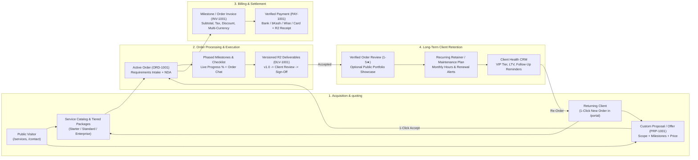
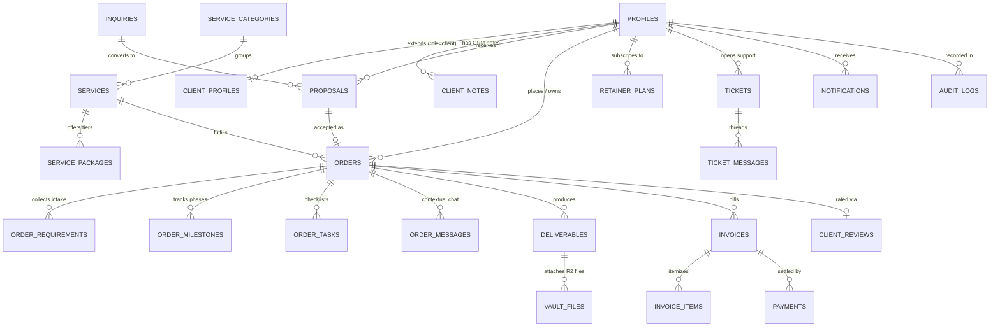

# Master Architecture, Design System & Service CRM Plan — `redwan.work` v2.0

> **Status:** Refined Master Plan (v2.1)  
> **Active Workspace:** `J:\DevDrive\redwan.work`  
> **Fresh Database:** Supabase PostgreSQL 17 (`project_id: bnutormrsrhjoktqzrux`, `eu-west-1`)  
> **Design System:** `tweakcn` (`J:\temp\theme\`) + `shadcn/ui` + **Tailwind CSS v4**  
> **Animation Engine:** **Motion** (`motion/react`) + **CSS** + **GSAP** (targeted canvas/timeline effects)  
> **External Services:** Cloudflare R2 (Public & Private Buckets), Resend, Cloudflare Turnstile, Google Blogger API v3, Vercel.

---

## 1. Executive Vision & Brand Positioning

`redwan.work` v2.0 is designed as both an authoritative **Personal Brand & Portfolio** and a **Full-Lifecycle Freelance Service Commerce, Order Execution & Client Retention Platform** for **Md Redwan Ahmed**:

### 1.1 Professional Identity & Multi-Disciplinary Service Pillars
- **Lead Credential:** **C|EH (Certified Ethical Hacker)** alongside **CCEP**, **CNSP**, **CAP**, published **Q1 Scopus & IEEE Researcher**, and **Founder & CEO of Fast Cyber Defense**.
- **Expanded Freelance & Consulting Scope:** Beyond offensive security, the platform is architected to take orders, process, deliver, and retain high-value clients across **5 core service pillars**:
  1. **Cybersecurity & Offensive Security (C|EH):** Web/API/Network Penetration Testing (VAPT), Cloud Security Audits, OSINT & Fraud/Scam Investigations, SIEM (Wazuh) Deployment, Security Hardening.
  2. **Full-Stack Web & Custom Software Engineering:** Next.js/React/TypeScript web platforms, Python/Django backends, SaaS MVPs, custom portals, API integrations, and performance/security refactoring.
  3. **Cloud, DevOps & Linux Infrastructure:** AWS/Azure/DigitalOcean architecture, Linux server administration (Ubuntu/CentOS), Docker, CI/CD pipelines (GitHub Actions, Jenkins), Nginx/Database administration.
  4. **Applied AI/ML & Intelligent Automation:** Custom ML models, phishing/anomaly detection, data clustering/analytics, and AI workflow automation.
  5. **Executive Tech Support, Digital Recovery & Retainers:** Hacked account/asset recovery, cloud drive/file restoration, proxy/fingerprint/OPSEC consulting, emergency troubleshooting, and recurring monthly technical retainers.

### 1.2 End-to-End Client Order & Relationship Loop
Unlike the legacy site—which only had a basic contact form and static tables—`redwan.work` v2.0 provides a complete **Order-to-Retention Pipeline**:

---

## 2. Design System (`tweakcn` + Tailwind CSS v4) & Antigravity Motion Architecture

### 2.1 Theme Tokens (`J:\temp\theme\index.css` & `layout.tsx`)
We have integrated your custom `tweakcn` theme directly with **Tailwind CSS v4** (`@import "tailwindcss";`, `@import "tw-animate-css";`, `@theme inline`):
- **Light Mode:** Cool alabaster background (`oklch(0.9842 0.0034 247.8575)`), deep navy foreground (`oklch(0.2077 0.0398 265.7549)`), authoritative slate-blue primary (`oklch(0.3462 0.0736 256.0397)`), and vibrant royal-blue accent (`oklch(0.5461 0.2152 262.8809)`).
- **Dark Mode:** Deep midnight-sapphire background (`oklch(0.1831 0.0309 263.3831)`), elevated slate card surfaces (`oklch(0.2351 0.0378 261.6534)`), luminous sky-blue primary (`oklch(0.7137 0.1434 254.6240)`), and royal electric-blue accent (`oklch(0.6231 0.1880 259.8145)`).
- **Typography:**
  - `--font-sans`: **Inter** (`letter-spacing: -0.015em`) for clean, high-trust editorial and dashboard legibility.
  - `--font-mono`: **JetBrains Mono** for `C|EH` security badges, reference codes (`ORD-1001`, `PRP-1001`, `INV-1001`, `TKT-1001`), financial figures, and technical tags.

### 2.2 Antigravity-Inspired Interactive Animation Specification (`Motion` + `CSS` + `GSAP`)

Every animation is engineered to make `redwan.work` feel alive and technologically advanced without sacrificing executive credibility or readability:

| Interaction Surface | Visual & Technical Behavior | Tech Used |
|---|---|---|
| **1. Hero Ambient Spotlight & Antigravity Particle Field** (`<AntigravityHeroField />`) | • **Pointer-Following Ambient Glow:** A soft, restrained blue radial spotlight (`radial-gradient(600px circle at var(--mouse-x) var(--mouse-y), oklch(from var(--accent) l c h / 0.12), transparent 70%)`) smoothed via `useMotionValue` & `useSpring` (`stiffness: 120, damping: 28`). • **Antigravity Micro-Dash Canvas:** Inspired by `antigravity.google.com`, a lightweight 60fps `<canvas>` layer renders sparse, floating directional micro-capsules/dashes in the blue-indigo-violet palette that gently drift and subtly orient/repel near the pointer. • **No custom cursor replacement**; native cursor remains fast and accessible. Automatically pauses when off-screen or under `prefers-reduced-motion`. | `motion/react` + HTML5 Canvas + `GSAP` quickSetter |
| **2. Hero Text & Credential Stagger** (`<HeroReveal />`) | • **Single-Pass Editorial Reveal:** Hero title (`Hi, I'm Md Redwan Ahmed`) reveals smoothly with custom cubic-bezier easing (`[0.22, 1, 0.36, 1]`), followed by a staggered (`80ms` step) entrance of:   1. `C|EH Certified Ethical Hacker` & Fast Cyber Defense badge   2. Multi-disciplinary tagline (Cybersecurity, Full-Stack Dev, Cloud & Tech Support)   3. Credential & capability pills (`C|EH`, `CCEP`, `CNSP`, `CAP`, `Scopus Q1`, `IEEE`)   4. Action buttons (*Order a Service*, *Client Portal*, *Upwork*, *Fiverr*) • **Zero continuous typewriter loops** so content stays effortlessly readable. | `motion/react` (`variants` + `staggerChildren`) |
| **3. Portrait Entrance & Hover Halo** (`<HeroPortrait />`) | • Circular photograph gently fades and rises into position on page load (`opacity: 0 → 1`, `y: 20 → 0`, `duration: 0.7s`). • On hover, an outer orbital blue ring (`border-accent/60`, soft outer box-shadow glow) smoothly expands and illuminates while the portrait photograph itself remains completely unchanged and dignified. | `motion/react` + CSS `@property` ring transition |
| **4. Card Micro-Tilt & Border Spotlight** (`<InteractiveCard />`) | • Service cards, project case studies, and certification cards subtly lift (`translateY(-4px)`) and apply a restrained 3D perspective tilt (`max ±2.5deg`) based on pointer position. • A subtle top-border and surface highlight follows the cursor across the card perimeter. | `motion/react` (`useMotionTemplate`) + CSS |
| **5. Navigation Indicator & Page Transitions** | • **Refined Navigation Indicator:** Sticky header features a shared-layout sliding pill/underline (`layoutId="active-nav-indicator"`) that glides smoothly between *Home*, *Services*, *Portfolio*, *Resume (Experience & Research)*, *Blogs*, and *Contact*. • **Page & Scroll Reveals:** Brief (`200ms`) fade/slide transitions between pages and viewport-triggered staggered section reveals (`whileInView={{ opacity: 1, y: 0 }}`, `viewport={{ once: true, margin: "-60px" }}`). | `motion/react` (`LayoutGroup`, `AnimatePresence`) |

---

## 3. Fresh Database Architecture (Supabase `bnutormrsrhjoktqzrux`)

Because we are running on a **brand-new PostgreSQL 17 instance (`bnutormrsrhjoktqzrux`)**, we will **not** copy the old 41-migration schema. Instead, we have designed a clean, purpose-built **v2 Service Commerce, Order Execution & Client Retention Schema** organized into **8 cohesive migrations**:

### 3.1 Detailed Migration Breakdown (`supabase/migrations/0001`–`0008`)

1. **`0001_extensions_sequences_and_enums.sql`**
   - Enables `pgcrypto`.
   - Sequences: `inquiry_num_seq` (`INQ-1001`), `proposal_num_seq` (`PRP-1001`), `order_num_seq` (`ORD-1001`), `deliverable_num_seq` (`DLV-1001`), `invoice_num_seq` (`INV-1001`), `payment_num_seq` (`PAY-1001`), `ticket_num_seq` (`TKT-1001`).
   - Enums:
     - `user_role`: `'admin'`, `'client'`
     - `client_tier`: `'standard'`, `'vip'`, `'retainer'`, `'enterprise'`
     - `service_pillar`: `'cybersecurity'`, `'development'`, `'cloud_devops'`, `'ai_ml'`, `'tech_support'`
     - `inquiry_status`: `'new'`, `'reviewing'`, `'proposal_sent'`, `'converted'`, `'archived'`
     - `proposal_status`: `'draft'`, `'sent'`, `'viewed'`, `'accepted'`, `'declined'`, `'expired'`
     - `order_status`: `'pending_requirements'`, `'queued'`, `'in_progress'`, `'in_review'`, `'revision_requested'`, `'completed'`, `'on_hold'`, `'cancelled'`
     - `order_priority`: `'standard'`, `'priority'`, `'urgent_24h'`
     - `pricing_model`: `'fixed_package'`, `'custom_milestone'`, `'hourly'`, `'retainer'`
     - `deliverable_status`: `'submitted'`, `'accepted'`, `'revision_requested'`
     - `invoice_status`: `'draft'`, `'issued'`, `'partially_paid'`, `'paid'`, `'overdue'`, `'void'`, `'refunded'`
     - `payment_method`: `'bank_transfer'`, `'bkash'`, `'nagad'`, `'wise'`, `'payoneer'`, `'paypal'`, `'card'`, `'crypto'`, `'manual'`
     - `payment_status`: `'submitted'`, `'confirmed'`, `'rejected'`
     - `ticket_category`: `'technical_support'`, `'security_incident'`, `'order_question'`, `'billing'`, `'retainer_request'`, `'general'`
     - `ticket_priority`: `'low'`, `'medium'`, `'high'`, `'urgent'`
     - `ticket_status`: `'open'`, `'in_progress'`, `'answered'`, `'awaiting_client'`, `'resolved'`, `'closed'`

2. **`0002_identity_and_client_relationship_crm.sql`**
   - **`profiles`:** Linked to `auth.users(id)` (`role`, `full_name`, `email`, `phone`, `whatsapp`, `country`, `timezone`, `avatar_url`, `is_active`, `last_seen_at`, `created_at`, `updated_at`).
   - **`client_profiles`:** Long-term relationship metadata (`user_id` PK, `company_name`, `company_role`, `website_url`, `industry`, `tier`, `acquisition_source`, `billing_address` JSONB, `tax_id`, `preferred_currency`, `lifetime_value_cents`, `total_orders_count`, `completed_orders_count`, `average_rating`, `tags` `text[]`, `next_followup_at`, `relationship_summary`).
   - **`client_notes`:** Admin-only CRM log (`id`, `client_id`, `author_id`, `note_type` `'general' | 'call_log' | 'followup' | 'preference'`, `body`, `is_pinned`, `followup_date`, `created_at`).
   - **`client_invitations`:** Secure token-tracked client invites with optional pre-linked `inquiry_id`, `proposal_id`, or `order_id`.
   - RLS & `public.is_admin()`, `public.caller_account_state()`, and `on_auth_user_created` trigger.

3. **`0003_service_catalog_and_tiered_packages.sql`**
   - **`services`:** Multi-disciplinary service definitions (`id`, `slug`, `pillar` `service_pillar`, `title`, `tagline`, `description`, `icon_name`, `tools_tags` `text[]`, `is_public`, `is_featured`, `sort_order`).
   - **`service_packages`:** Orderable package tiers per service (`id`, `service_id`, `tier_name` `'Starter' | 'Standard' | 'Enterprise' | 'Custom'`, `price_cents`, `currency`, `is_starting_price`, `delivery_days`, `revisions_included`, `features` `jsonb`, `intake_questions` `jsonb`, `is_active`).
   - Pre-seeded with Redwan's 5 core service pillars (C|EH Penetration Testing & VAPT, OSINT & Incident Recovery, Full-Stack Next.js/Python Development, Cloud/Linux Server Hardening & DevOps, Executive Tech Support & Custom Consulting).

4. **`0004_inquiries_consent_and_proposals.sql`**
   - **`consent_policies` & `rate_limits`:** Token-bucket/window rate limiting (`consume_rate_limit`) and GDPR consent policy version registry pre-seeded with active policy `v1` so `/contact` works out of the box.
   - **`inquiries` & `inquiry_files`:** Public `/contact` and portal quote requests (`code` `INQ-1001`, contact details, `service_pillar`, `services_requested` `jsonb`, `project_summary`, `budget_min`, `budget_max`, `urgency`, `nda_required`, `ip_hash`, `consent_version`, `consent_at`, `status`, `converted_client_id`, `converted_order_id`).
   - **`proposals` & `proposal_milestones`:** Custom quotes/statements of work (`code` `PRP-1001`, `client_id`, `inquiry_id`, `title`, `pillar`, `scope_summary`, `deliverables_summary`, `total_cents`, `currency`, `estimated_days`, `revisions_included`, `valid_until`, `status`, `accepted_at`).
   - Atomic RPC: `accept_proposal_and_create_order(p_proposal_id, p_actor_id)` — converts an accepted proposal directly into an active `orders` row + `order_milestones` + initial `invoices` draft/issue!

5. **`0005_orders_execution_and_deliverables_vault.sql`**
   - **`orders`:** The core engagement entity (`id`, `code` `ORD-1001`, `client_id`, `service_id`, `package_id`, `proposal_id`, `inquiry_id`, `title`, `pillar`, `status` `order_status`, `priority` `order_priority`, `pricing_model`, `subtotal_cents`, `discount_cents`, `tax_cents`, `total_cents`, `currency`, `progress_percent`, `revisions_included`, `revisions_used`, `nda_required`, `nda_accepted_at`, `started_at`, `due_at`, `delivered_at`, `completed_at`, `archived_at`).
   - **`order_requirements`:** Structured onboarding intake answers (`order_id`, `responses` `jsonb`, `target_scope_notes`, `submitted_by`, `submitted_at`, `verified_by_admin_at`).
   - **`order_milestones`:** Phased execution (`id`, `order_id`, `title`, `description`, `amount_cents`, `currency`, `weight_percent`, `position`, `status` `'pending' | 'in_progress' | 'delivered' | 'approved'`, `due_date`, `completed_at`).
   - **`order_tasks`:** Actionable checklist items (`id`, `order_id`, `milestone_id`, `title`, `is_client_visible`, `is_completed`, `position`, `completed_at`).
   - **`vault_files`:** Unified R2 file registry (`id`, `bucket` `'public' | 'private'`, `r2_key`, `owner_client_id`, `order_id`, `deliverable_id`, `ticket_id`, `invoice_id`, `uploaded_by`, `filename`, `mime_type`, `size_bytes`, `created_at`, `deleted_at`).
   - **`deliverables`:** Formal versioned delivery drops (`id`, `code` `DLV-1001`, `order_id`, `milestone_id`, `version_label` e.g. `'v1.0'`, `title`, `release_notes`, `status` `'submitted' | 'accepted' | 'revision_requested'`, `client_feedback`, `submitted_by`, `submitted_at`, `reviewed_by`, `reviewed_at`).
   - Atomic RPC: `review_order_deliverable(p_deliverable_id, p_actor_id, p_decision, p_feedback)` — locks deliverable state on acceptance or increments `revisions_used` and transitions order to `revision_requested`.

6. **`0006_order_chat_and_support_tickets.sql`**
   - **`order_messages`:** Contextual chat thread inside every Order workspace (`id`, `order_id`, `author_id`, `body`, `is_internal_note`, `attachment_file_ids` `uuid[]`, `created_at`).
   - **`tickets` & `ticket_messages`:** Standalone or order-linked support & warranty tickets (`code` `TKT-1001`, `client_id`, `order_id`, `category`, `priority`, `subject`, `status`, `first_responded_at`, `resolved_at`, `last_message_at`), with `is_internal_note` support for admin triage notes and automatic status/timestamp triggers.

7. **`0007_invoicing_payments_and_retention.sql`**
   - **`invoices` & `invoice_items`:** (`code` `INV-1001`, `client_id`, `order_id`, `milestone_id`, `status`, `currency`, `subtotal_cents`, `discount_cents`, `tax_rate_bps`, `tax_cents`, `total_cents`, `amount_paid_cents`, `issued_at`, `due_at`, `paid_at`, `payment_instructions`, `notes`, `immutable_snapshot` `jsonb`).
   - **`payments`:** (`code` `PAY-1001`, `invoice_id`, `order_id`, `client_id`, `method`, `reference`, `amount_cents`, `currency`, `proof_file_id`, `status`, `rejection_reason`, `submitted_at`, `reviewed_by`, `reviewed_at`).
   - **`retainer_plans`:** Long-term client maintenance/retainer subscriptions (`id`, `client_id`, `title`, `pillar`, `monthly_fee_cents`, `currency`, `hours_per_month`, `hours_used_current_period`, `billing_cycle` `'monthly' | 'quarterly' | 'annual'`, `status` `'active' | 'paused' | 'cancelled'`, `current_period_start`, `current_period_end`, `next_invoice_date`).
   - **`client_reviews`:** Post-order satisfaction & testimonial capture (`id`, `order_id` unique, `client_id`, `rating_overall` 1–5, `rating_communication` 1–5, `rating_quality` 1–5, `rating_timeliness` 1–5, `headline`, `review_text`, `is_public_approved`, `created_at`).
   - Atomic RPC: `review_invoice_payment(p_payment_id, p_admin_id, p_decision, p_reason)` — confirms payment, recomputes `invoices.amount_paid_cents` & `status` (`partially_paid` / `paid`), and updates `client_profiles.lifetime_value_cents`!

8. **`0008_audit_notifications_outbox_and_rpcs.sql`**
   - **`audit_logs`:** Immutable ledger (`id`, `actor_id`, `actor_role`, `client_id`, `order_id`, `entity_type`, `entity_id`, `action`, `summary`, `metadata` `jsonb`, `ip_hash`, `created_at`) protected by an update/delete refusal trigger.
   - **`notifications`:** In-app notification center (`id`, `recipient_id`, `title`, `body`, `href`, `category`, `is_read`, `read_at`, `created_at`).
   - **`email_outbox` & `email_log`:** Durable Resend email queue with retry count, lock token, and delivery audit trail.
   - **Dashboard RPCs:** `admin_command_center_metrics(p_admin_id)` and `client_portal_overview(p_client_id)`.

---

## 4. Public Site Architecture & UX Specifications (`Phase 2`)

1. **Home Page (`/`):**
   - **Hero Section:** `<AntigravityHeroField />` (pointer-following blue ambient spotlight + subtle floating particle canvas), `<HeroReveal />` staggered typography featuring **Md Redwan Ahmed**, **C|EH Certified Ethical Hacker · Security & Software Engineering Consultant · Founder & CEO of Fast Cyber Defense**, credential badges (`C|EH`, `CCEP`, `CNSP`, `CAP`, `Scopus Q1`), and `<HeroPortrait />` with subtle blue hover halo.
   - **5-Pillar Service Catalog Showcase:** Interactive tilt cards covering *Cybersecurity & VAPT*, *Full-Stack Development*, *Cloud & Server Ops*, *AI/ML Solutions*, and *Executive Tech Support & Recovery* with direct **"Order / Request Quote"** links.
   - **Featured Case Studies & Portfolio Carousel:** Interactive cards with category filters.
   - **Verified Client Testimonials:** Pulls static + database-approved `client_reviews`.
2. **Interactive Services & Direct Order Catalog (`/services`):**
   - Filterable by the 5 Service Pillars.
   - Displays transparent package tiers (*Starter*, *Standard*, *Enterprise*, *Custom Quote*) with turnaround times, included deliverables, and a **"Start Order / Request Custom Quote"** button that pre-selects the service in `/portal/orders/new` (if logged in) or `/contact` (if guest).
3. **Resume — Experience, Certifications & Research (`/resume`):**
   - Ported from `redwan.work_old` with prominent **C|EH (Certified Ethical Hacker)** certification highlight, interactive section navigation (*Summary*, *Experience*, *Certifications*, *Research & Publications*, *Leadership*, *Education*), scroll reveals, and the 1-click **A4 Print-to-PDF** generator (`PrintableResume`).
4. **Blogs & Publications (`/blogs`):**
   - Powered by Google Blogger API v3 (`lib/blogger.ts`) with module TTL cache and `/api/revalidate`.
   - Upgraded UI/UX: Featured Hero Article card on Page 1, instant search bar, topic/label filter pills, reading-time calculation (`X min read`), interactive card lift, and an enhanced article reader modal (`BlogPreviewModal`).
5. **Contact & Service Order Intake (`/contact`):**
   - Preserves all security guarantees of `redwan.work_old` (Cloudflare Turnstile, IP hash rate limiting, explicit GDPR consent, up to 5 R2 presigned file attachments) while supporting all 5 service pillars (Cybersecurity, Development, Cloud/DevOps, AI/ML, Tech Support) and pre-filled package selection from `/services`.
6. **Legal & Compliance Pages (`/privacy` & `/tos`):**
   - **`/privacy`:** GDPR & ISO/IEC 27001-aligned Data & Privacy Policy.
   - **`/tos`:** Comprehensive Terms of Service covering Cybersecurity Rules of Engagement (authorization requirement for VAPT), Software/Tech Support delivery terms, Order & Milestone Revisions, Invoicing & Payment Terms, Confidentiality/NDA, and IP Transfer upon full payment.

---

## 5. Admin & Client Portal Architecture (`Phases 4 & 5`)

### 5.1 Admin Command Center (`/admin/*`) — Built to Take Orders, Process, Deliver & Retain Clients

| Route | Core Capabilities |
|---|---|
| **`/admin` (Command Center)** | • **Executive KPIs:** Total Revenue Collected, Active Orders in Queue/Progress, Pending Proposals, Unpaid/Overdue Invoices, Open Urgent Tickets, Client Retention Rate. • **Needs Attention Queue:** 1-click access to new inquiries, orders awaiting processing, payment proofs awaiting confirmation, and client follow-up reminders due today. • **Live Audit Stream:** Real-time feed of all client & system events. |
| **`/admin/inquiries` & `/admin/proposals`** | • **Inquiry Triage:** Inspect incoming `/contact` leads, download R2 attachments, view budget/urgency/NDA. • **Proposal & Custom Offer Builder (`PRP-1001`):** Build a multi-milestone or fixed-price custom offer for any lead or existing client and dispatch via Resend. • **1-Click Convert to Client & Order:** Automatically provisions the client account, sends invite link, and creates `ORD-1001`. |
| **`/admin/orders` & `/admin/orders/[id]`** | • **Kanban & Table Views:** Track every order across `Pending Requirements` → `Queued` → `In Progress` → `In Review` → `Revision Requested` → `Completed`. • **Order Execution Workspace:**   - **Requirements & Scope Tab:** View client intake responses, NDA status, and target URLs/specs.   - **Milestones & Tasks Tab:** Manage phased milestones, check off tasks (auto-updating client progress %), and 1-click generate milestone invoices.   - **Deliverables Dropzone Tab:** Upload versioned R2 deliverables (`v1.0`, `v1.1`, `final`) with release notes; track client sign-off or revision feedback.   - **Contextual Order Chat Tab:** Direct messaging with the client + private **Admin Internal Notes**. |
| **`/admin/clients` & `/admin/clients/[id]`** | • **Long-Term Relationship CRM:** Client tier badges (`VIP`, `Retainer`, `Repeat`), Lifetime Value (LTV), total orders, average review score, tags, and **Next Follow-up Date** scheduler. • **Client 360° Drawer/Page:** View all past/active orders, proposals, invoices, retainer plans, private CRM call/meeting notes (`client_notes`), and account status controls (invite, reset password, activate/deactivate). |
| **`/admin/retainers` & `/admin/reviews`** | • **Retainer Manager:** Track recurring monthly maintenance/support plans, log hours used vs. included, and trigger renewal invoices. • **Client Reviews Moderation:** View post-order 1–5★ client reviews and toggle `is_public_approved` to feature on the public site. |
| **`/admin/invoices` & `/admin/invoices/[id]`** | • **Invoice Builder (`INV-1001`):** Create itemized invoices with tax rate (%), discount, currency (`USD`, `BDT`, `EUR`, `GBP`), due date, and payment instructions. • **Payment Proof Verification (`PAY-1001`):** Inspect client-submitted payment references and R2 receipt uploads (Bank Transfer, bKash, Wise, PayPal, Card); 1-click **Confirm** or **Reject with Reason**. |
| **`/admin/tickets` & `/admin/tickets/[id]`** | • **Support & Warranty Desk (`TKT-1001`):** Filter by Priority (`urgent`–`low`), Category (`security_incident`, `technical_support`, `billing`, etc.), and Status; reply with R2 attachments or internal notes. |
| **`/admin/services`, `/admin/audit`, `/admin/emails`, `/admin/assets`** | • **Service Catalog Manager:** Edit public/portal service offerings and package tiers dynamically. • **Immutable Audit Log:** Searchable/filterable ledger of all workspace mutations. • **Email Outbox & R2 Public Asset Manager:** Monitor/retry Resend emails and upload public CDN assets. |

### 5.2 Client Portal (`/portal/*`) — Frictionless Ordering, Tracking, Delivery Sign-Off & Re-Ordering

| Route | Core Capabilities |
|---|---|
| **`/portal` (Client Dashboard)** | • **Action Required Banner:** Prompts client if an order needs requirements submitted, a proposal is awaiting acceptance, a deliverable is ready for sign-off, or an invoice is due. • **Overview Cards:** Active Orders & Live Progress %, Deliverables Ready, Open Balance, Active Retainer Hours Remaining. • **1-Click "Place New Order / Request Service" CTA** for instant repeat business. |
| **`/portal/services` & `/portal/orders/new`** | • **In-Portal Service Store & Custom Order Request:** Returning clients can browse all 5 service pillars (Cybersecurity, Full-Stack Dev, Cloud/DevOps, AI/ML, Tech Support), pick a package tier or request a custom quote, and submit an order in seconds without re-entering their profile details. |
| **`/portal/proposals` & `/portal/proposals/[id]`** | • **Interactive Proposal Viewer (`PRP-1001`):** Review custom scope, milestones, timeline, and pricing prepared by Redwan; click **"Accept Proposal & Start Order"** to kick off the engagement immediately. |
| **`/portal/orders` & `/portal/orders/[id]`** | • **Visual Order Tracker:** Step-by-step progress pipeline (`Order Placed` → `Requirements` → `In Progress` → `In Review` → `Completed`). • **Onboarding Requirements Form:** Submit project inputs, URLs, or files to start the order. • **Deliverables & Sign-Off Panel:** Download deliverables via short-lived presigned R2 URLs and click **"Accept Delivery"** or **"Request Revision"** with structured notes. • **Order Discussion Thread:** Chat directly with Redwan in the context of the order and share files. • **Leave Review Prompt:** Upon order completion, rate the experience (1–5★) and leave a testimonial. |
| **`/portal/files` (Secure R2 Vault)** | • Centralized, searchable vault of all deliverables, reports, source code archives, and attachments across all orders, with checksum, file size, version tag, and secure presigned download. |
| **`/portal/invoices` & `/portal/invoices/[id]`** | • **Statement of Account:** Total billed, total paid, and current balance due. • **Printable A4 Invoice & Receipt View (`INV-1001`):** Clean print/PDF layout. • **Submit Payment Drawer:** Select payment method (`Bank Transfer`, `bKash`, `Wise`, `Payoneer`, `PayPal`, `Card`), enter transaction reference, specify partial/full amount, and upload payment proof screenshot/PDF to R2. |
| **`/portal/retainers` & `/portal/tickets`** | • **My Retainers:** View active monthly maintenance/support plan, hours used vs. remaining, and renewal date. • **24/7 Support & Warranty Tickets (`TKT-1001`):** Open general or order-linked tickets with priority and file attachments. |
| **`/portal/profile`** | • Manage personal & company details, billing address, tax ID, WhatsApp/phone, timezone, password security, and view personal account activity log. |

---

## 6. Phased Implementation Roadmap

### Phase 0: Project Foundation, Tailwind v4 + `tweakcn` Theme & Motion Stack *(Completed)*
- [x] Initialize Next.js 16.4.5 (App Router, React 19, TypeScript strict mode) in `J:\DevDrive\redwan.work`.
- [x] Upgrade styling to **Tailwind CSS v4** (`@tailwindcss/postcss`, `tw-animate-css`) and apply the custom `tweakcn` OKLCH theme (`J:\temp\theme\index.css` & `layout.tsx` with `Inter` + `JetBrains Mono`).
- [x] Install animation packages (`motion`, `gsap`) and Zod validation (`zod`).

### Phase 1: Fresh Supabase Database Provisioning (`bnutormrsrhjoktqzrux`) & Core Infrastructure
- [ ] **1.1 Author & Apply Fresh v2 Migrations (`0001`–`0008`) via Supabase MCP:** Create the ground-up schema (`profiles`, `client_profiles`, `client_notes`, `services`, `service_packages`, `inquiries`, `proposals`, `orders`, `order_requirements`, `order_milestones`, `order_tasks`, `deliverables`, `vault_files`, `order_messages`, `tickets`, `invoices`, `payments`, `retainer_plans`, `client_reviews`, `audit_logs`, `notifications`, `email_outbox`) on `bnutormrsrhjoktqzrux`.
- [ ] **1.2 Seed Service Catalog & Consent Policy `v1`:** Seed Redwan's 5 service pillars, tiered packages, and active GDPR consent policy so public and portal flows work immediately.
- [ ] **1.3 Auth, Edge Proxy & Core Services (`proxy.ts`, `lib/auth/*`, `lib/r2.ts`, `lib/email/*`, `lib/crm/audit.ts`):** Implement SSR authentication, role-based routing, R2 presigned upload/download endpoints, Resend durable email outbox, and unified audit/notification logging.

### Phase 2: Antigravity Motion Primitives & Public Site Overhaul
- [ ] **2.1 Build Reusable Animation Primitives (`components/motion/*`):**
  - `<AntigravityHeroField />` (pointer-following blue ambient spotlight + subtle Antigravity directional micro-dash canvas).
  - `<HeroReveal />` & `<HeroPortrait />` (staggered text/credential reveal + circular portrait fade-rise & blue hover ring).
  - `<InteractiveCard />` (pointer-aware subtle 3D tilt/lift + border highlight).
  - `<ScrollReveal />` & animated `<Navigation />` indicator (`layoutId`).
- [ ] **2.2 Upgrade Home (`/`), Services (`/services`), and Portfolio (`/portfolio`):** Highlight **C|EH Certified** positioning, all 5 service pillars (Cybersecurity, Development, Cloud/DevOps, AI/ML, Tech Support), and interactive package cards.
- [ ] **2.3 Port & Enhance `/resume`, `/contact`, `/blogs`, `/privacy`, and Build `/tos`:**
  - Port `/resume` (with C|EH highlight + `PrintableResume` A4 PDF export) and `/contact` (Turnstile + R2 attachments + all 5 service pillars).
  - Overhaul `/blogs` UI/UX (featured post, instant search & tag filter, reading time, enhanced preview modal).
  - Port `/privacy` and create `/tos` (Terms of Service).

### Phase 3: Admin Command Center — Order, Delivery & Relationship CRM (`/admin/*`)
- [ ] **3.1 Admin Shell, Notification Center & Executive Dashboard (`/admin`):** KPI cards, action-required queue, revenue & order pipeline metrics, and live audit stream.
- [ ] **3.2 Inquiries, Proposals & Client Relationship CRM (`/admin/inquiries`, `/admin/proposals`, `/admin/clients`):** Inquiry drawer, Proposal Builder (`PRP-1001`), 1-click Lead-to-Client/Order conversion, Client 360° profile with LTV, tags, private CRM notes, and follow-up scheduler.
- [ ] **3.3 Order Execution & Deliverables Workspace (`/admin/orders`, `/admin/orders/[id]`):** Order status pipeline, requirements viewer, milestones & tasks manager, R2 versioned Deliverable Uploader (`DLV-1001`), and contextual Order Chat with internal notes.
- [ ] **3.4 Invoicing, Payment Verification, Retainers & Support (`/admin/invoices`, `/admin/retainers`, `/admin/reviews`, `/admin/tickets`, `/admin/audit`, `/admin/emails`, `/admin/assets`):** Full billing engine, payment proof confirmation, retainer tracking, review moderation, support desk, and audit/email/asset logs.

### Phase 4: Client Portal — Ordering, Tracking, Sign-Off & Retention (`/portal/*`)
- [ ] **4.1 Client Shell, Dashboard & In-Portal Service Ordering (`/portal`, `/portal/services`, `/portal/orders/new`, `/portal/proposals`):** Action items banner, 1-click new service order, and interactive Proposal acceptance.
- [ ] **4.2 Client Order Workspace & Deliverable Sign-Off (`/portal/orders`, `/portal/orders/[id]`, `/portal/files`):** Visual progress tracker, requirements intake form, presigned R2 deliverable downloads, **"Accept Delivery / Request Revision"** workflow, order chat, and post-order 1–5★ review form.
- [ ] **4.3 Client Billing, Payment Submission, Retainers & Support (`/portal/invoices`, `/portal/retainers`, `/portal/tickets`, `/portal/profile`):** Printable A4 invoices, payment submission with R2 receipt upload, retainer usage view, support tickets, and profile/security settings.

### Phase 5: End-to-End Verification, Security Audit & Build Sign-Off
- [ ] **5.1 Static, Type & Build Verification:** `npx next typegen`, `npx tsc --noEmit`, `npm run lint`, `npm run build`.
- [ ] **5.2 Database RLS & Security Verification:** Run Supabase security/performance advisors via MCP and verify tenant isolation across all tables.

---

## 3A. Final Review Amendments (v2.2)

> [!NOTE]
> These amendments take priority over anything above that conflicts with them.

### Order lifecycle fixes (protect the freelancer)
| # | Change | Why |
|---|---|---|
| A1 | Add order status **`awaiting_payment`** plus `deposit_percent` on packages and proposals (default 50% for new clients, 0% allowed for VIP/retainer). Work does not start until the deposit invoice is paid. | v2.1 let an order start with no payment. |
| A2 | Add status **`delivered`** and **auto-accept**: if the client does not respond within `auto_accept_days` (default 3), the deliverable is accepted automatically by a daily job. | Without it, a client who goes silent can block completion and the final payment indefinitely. |
| A3 | **Revision limits are enforced in the RPC**. When `revisions_used ≥ revisions_included`, the client sees "Request paid revision", which opens a change-order proposal. | Prevents unlimited free revisions. |
| A4 | Add **`cancellation_requests`** and **`credit_notes`** (for refunds and partial refunds) instead of a bare `refunded` invoice status. Invoices stay immutable after issue. | Gives refunds and disputes an audit trail. |

### Cybersecurity engagement controls (C\|EH)
| # | Change |
|---|---|
| B1 | Every `cybersecurity` order **must have a signed Rules of Engagement / Authorization record** (`engagement_authorizations`) before it can enter `in_progress`. The record holds the target list, the client's attestation that they own or control the targets, the testing window, excluded systems, an emergency contact, and the signer's name, IP hash and timestamp. This is enforced in the DB, not just the UI. |
| B2 | **Sensitive deliverables** (pentest reports, recovery data): private R2 only, presigned URLs that expire in 60 seconds or less, **every download written to `audit_logs`**, and a `retention_until` date with a purge job (default 90 days after completion unless the client is on a retainer). |
| B3 | **Admin MFA is required** (Supabase Auth TOTP, AAL2 enforced in `proxy.ts` and in the RPCs that check admin). Client MFA is optional but encouraged. |

### Data model corrections
| # | Change |
|---|---|
| C1 | **Multi-currency correctness:** every invoice and payment stores `currency` plus `fx_rate_to_usd` captured at confirmation. `lifetime_value_cents` and all KPIs are computed in **USD** only. v2.1 would have summed BDT and USD as if they were the same currency. |
| C2 | **Payment methods:** remove `crypto` (regulatory risk in Bangladesh) and `card` (there is no card gateway, so it cannot be verified). Keep `bank_transfer`, `bkash`, `nagad`, `wise`, `payoneer`, `paypal`, `manual`. A gateway can be added later behind a `payment_provider` column. |
| C3 | Every migration applied through MCP is **also committed** to `supabase/migrations/` with identical content. TypeScript types are generated into `lib/supabase/database.types.ts` after each migration. |
| C4 | Files copied from the old repo (`lib/r2.ts`, `lib/blogger.ts`, `lib/supabase/*`) are **reference only**. `r2.ts` key patterns are tied to the old schema and must be rewritten for `vault_files`. |

### Infrastructure and operations
| # | Change |
|---|---|
| D1 | **Background jobs run on Supabase `pg_cron` + `pg_net`** (email outbox every minute, auto-accept, overdue invoices, retainer renewals, R2 retention). Vercel Hobby cron only runs once a day. |
| D2 | ⚠️ **Hosting:** Vercel's Hobby plan is for non-commercial personal use. Once the site takes paid orders, plan to move to **Vercel Pro** (or another host) before launch. |
| D3 | **Testing is added per phase, not left to the end:** SQL tests for every RLS policy and money RPC (client A can never read client B's data; payment confirmation updates totals exactly once), Vitest for Zod schemas and money math, and Playwright smoke tests for order → deliver → pay. |

### Frontend corrections
| # | Change |
|---|---|
| E1 | **Regenerate the shadcn/ui components for Tailwind v4** (`npx shadcn@latest add --all --overwrite`). The 38 copied components are the legacy v3 style (`forwardRef`, v3 `ring`/`shadow`/`outline` semantics). They build, but they won't match the tweakcn tokens exactly. Then remove `tailwindcss-animate` and `autoprefixer`. |
| E2 | Scope the `react-hooks/set-state-in-effect` lint exemption to the carousel only, not the whole project. |
| E3 | **GSAP is optional.** The hero spotlight and particle canvas use Motion springs and `requestAnimationFrame`. GSAP is added only if a timeline genuinely needs it, which keeps the bundle small. All motion respects `prefers-reduced-motion`, and the canvas pauses when off-screen or the tab is hidden. |
| E4 | **Navigation:** Home · Services · Work (projects/case studies) · About (experience, certifications and research, with deep links to `/resume#…`) · Blog · Contact, plus a **Client Portal** button. This covers the About/Experience/Research pages you asked for without splitting the resume into thin pages. |

### Release slicing (ship value sooner)
- **Release 1 (MVP):** public site + auth/MFA + inquiries → proposals → orders (deposit, RoE, milestones, deliverables, auto-accept) → invoices/payments → client portal for the same flow + audit log + email outbox.
- **Release 2:** retainers, reviews with public showcase, kanban view, CRM follow-up reminders, Service Catalog Manager UI, public asset manager.
